# TP2

## Rétrospective
### Métriques

- Le temps pour implémenter une feature varie entre 1 et 3 jours, pour une moyenne de 2 jours.
- Le temps pour intégrer une pull request varie entre 1 heure et 7 jours, pour une moyenne de 56.67 heures.
- Le nombre de personnes sur chaque feature varie entre 1 et 2 personnes, pour une moyenne de 2 personnes.
- Le nombre de personnes qui évaluent une pull request est dans tous les cas 1.
- Le nombre d'issues en cours d'implémentation varie entre 0 et 4 issues pour une moyenne de 3.
- Le nombre de pull request en cours de review en même temps varie entre 1 et 2, pour une moyenne de 1.

### Réflexions

1. Le temps d'implémentation de chaque fonctionnalité semble approprié, mais le début de leur implémentation est un peu trop proche de la date de remise. Pour les pull requests, 2 jours pour review semble assez pour laisser le temps à l'équipe d'évaluer le code; 1 heure est bien trop trop court et une semaine est bien trop long.
2. Le temps d'implémentation ou de l'intégration nécessaire pour une fonctionnalité varie grossièrement comme une fonction quadratique selon la taille de l'issue ou de la pull request : un issue trop court (peu explicatif) demandera plus de temps à effectuer, car les spécifications ne seront pas claires; en revanche un issue trop court créera une complexité non nécessaire, augmentant aussi le temps d'implémentation. La concision et la clarté sont de mise.
3. Afin d'améliorer notre processus : 
    1) Le temps de review pour chaque pull request devrait être un peu plus long, et le nombre d'évaluateurs devrait idéalement être de 2 afin d'assurer une meilleure qualité du code. Cependant, certaines ont pris beaucoup trop de temps à être intégrées. Alors, review une PR ne devrait pas trainer plus de 4 jours.
    2) Une dâte de fin préventive devrait être établie - finir l'implémentation de chaque issue idéalement 5 jours avant la remise afin d'avoir le temps de review, puis intégrer et d'effectuer les correctifs. La création d'un diagramme de Gantt pourrait aider.
    3) Une meilleure clarification lors de l'attribution des tâches serait la bienvenue. Un survol de chacune des tâches afin de s'entendre sur la manière d'implémenter ou de structurer les différentes composantes permettrait de diminuer la modification de code après-coup.

## Architecture
### Explication et Problèmes identifiés

Commençons par l'API : les classes OfferResource, ProductResource et SellerResource s'occupent des requêtes reçues par le serveur. Elles retournent des instances DTO OfferResponse, ProductResponse et de SellerResponse. Elles créent à partir des requêtes les objets du domaine, Offer, Product et Seller, qui sont ensuite stockés dans ProductRepository et SellerRepository. Les Offer sont contenus dans les instances des Product.

Les classes permettent une navigation plus aisée de la base de code : elles ont une seule responsabilité. Les Classe Resource ne font que recevoir les requêtes et envoyer les Response, les objets du modèle décrivent leurs attributs et les valident et enfin les repository les recense. Les packages séparent les grands rôles de l'application : l'API est l'interface de communication du système avec l'extérieur et le domaine gère et stocke ces informations.

L'API déborde un peu sur le domaine; depuis les objets json les objets Offer, Product et Seller sont directement créés, puis les classes Resource appellent directement certaines de leurs méthodes pour finalement les ajouter au Repository approprié. Les classes Resource devraient créer à partir des json des DTO-requête, qui seraient envoyés vers des classes de transition : des Assembleur qui convertiraient les objets requêtes en objets du domaine et qui créeraient des objets réponses en retour, et ce afin de mieux controller la conversion et le partage d'informations entre les classes.

### L'architecture de classes
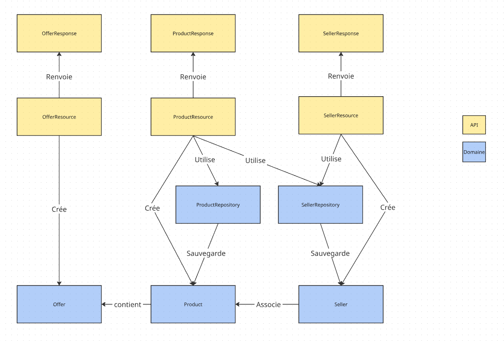

## ScreenShots

### GithubProject
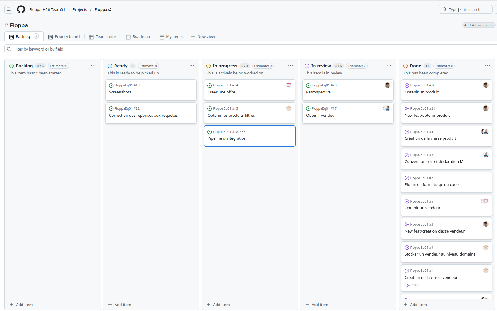

### Milestone
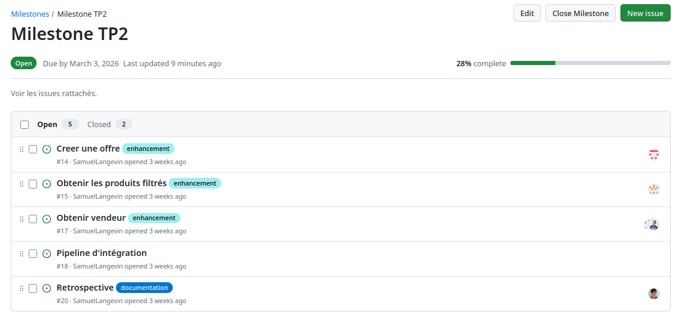

### Issue 1
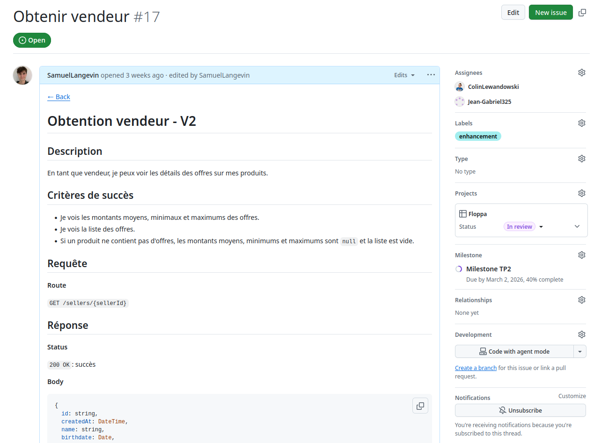

### Issue 2
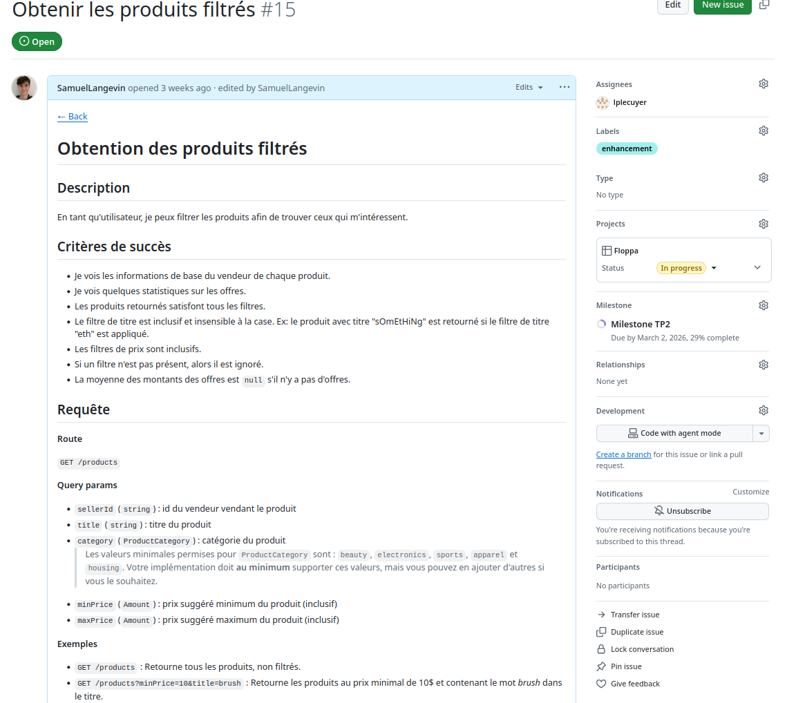

### Issue 3
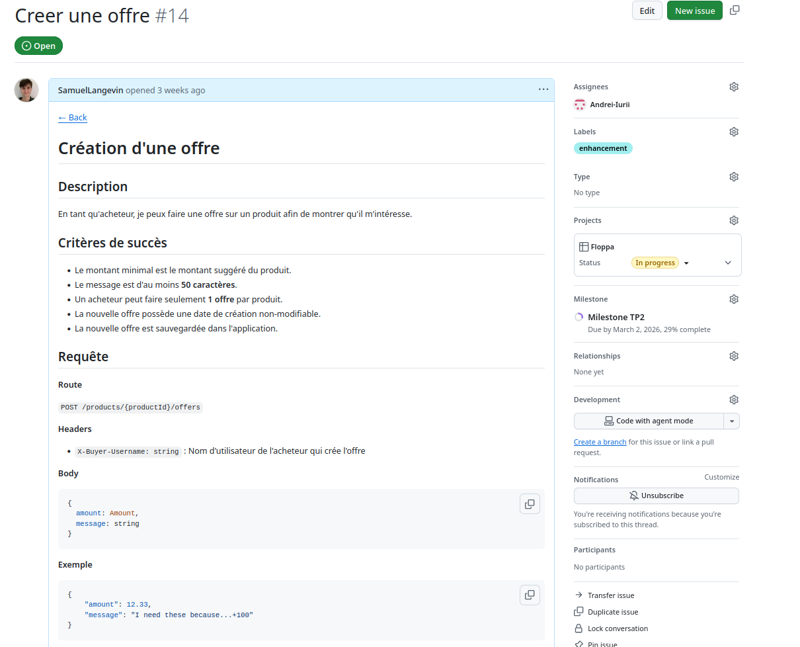

### Pull request 1
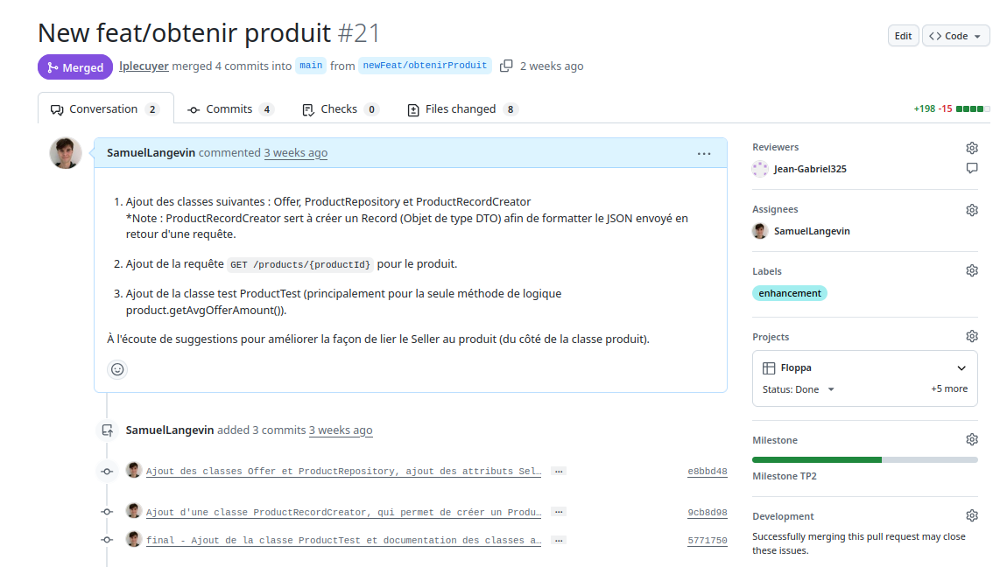
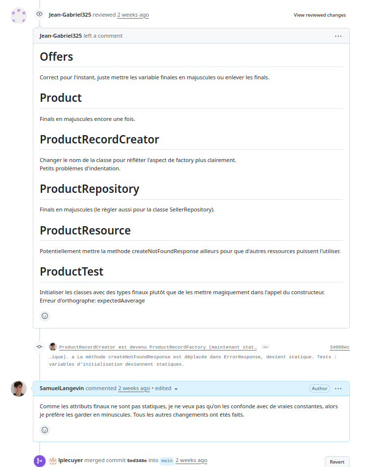

### Pull request 2 
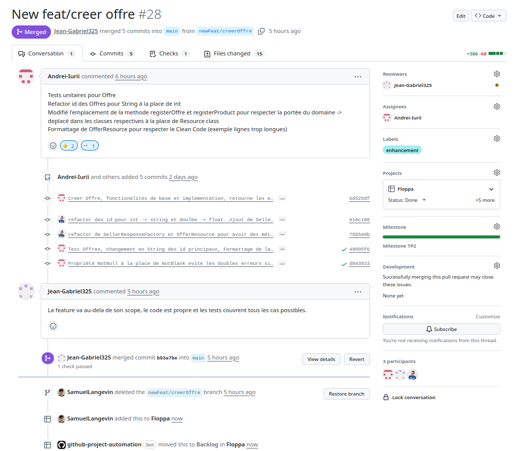

### Pull request 3
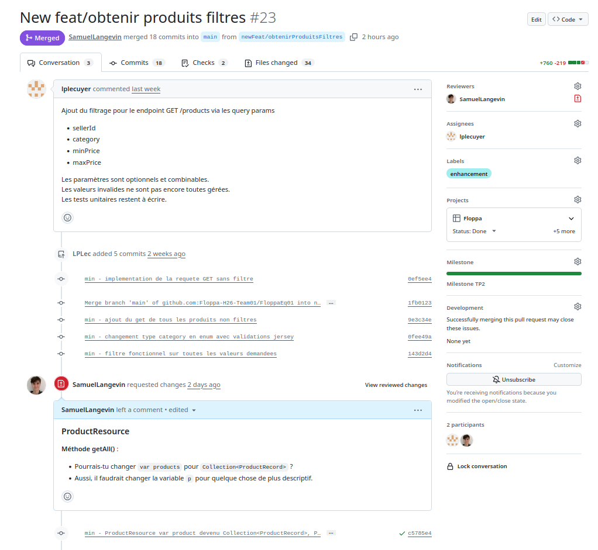
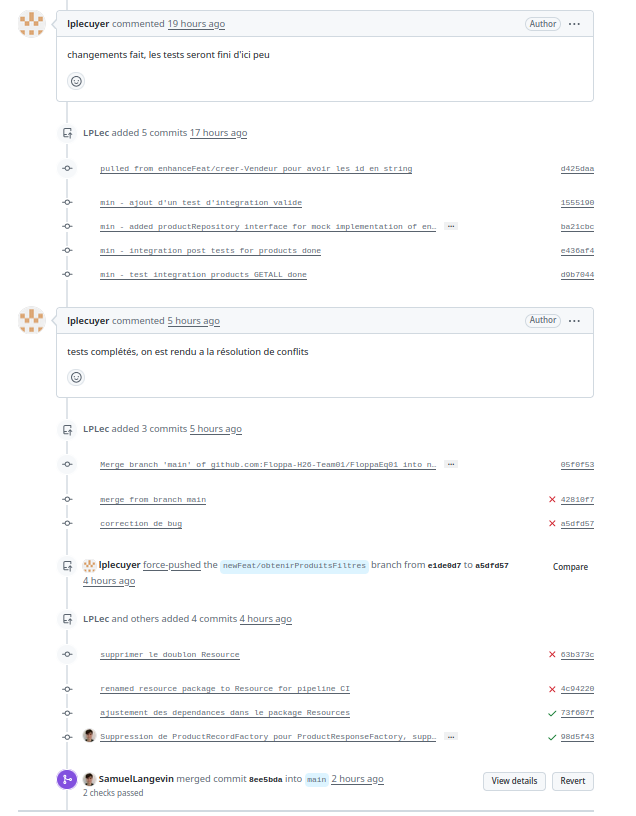

### Arbre de commits
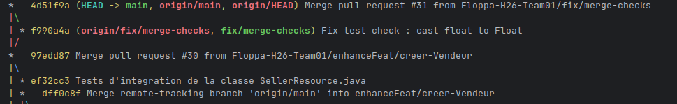
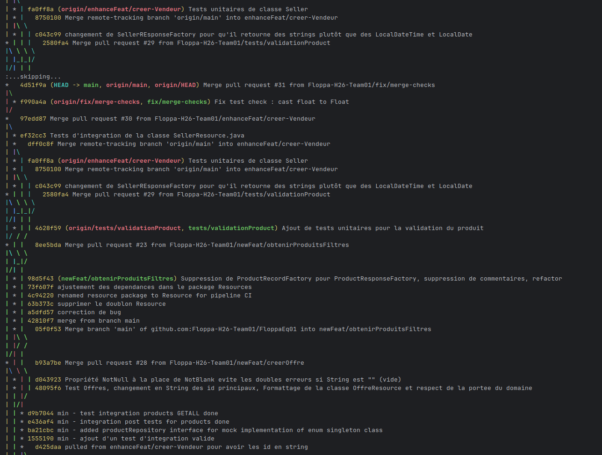
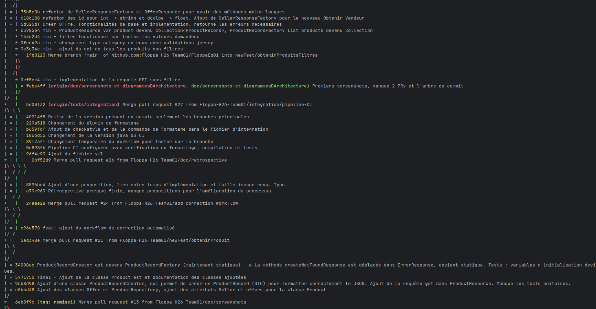

## Déclaration d'utilisation de l'IA
1. Commencer le travail sans utiliser d’IA.
2. Si le problème est en rapport avec le travail d’un coéquipier, lui demander de l’aide en premier.
3. Si un problème est rencontré, rechercher une solution sur google avec des sites fiables (StackOverflow, W3Schools, GeeksForGeeks) ou les notes de cours.
4. Si le problème persiste, demander de l’aide à un coéquipier.
5. Si rien n’est réglé, décrire le problème à ChatGPT textuellement et lui demander des pistes de la source de ce problème (sans scanner tout le code).
6. Si le problème est toujours là, utiliser ChatGPT pour le régler en formattant sa solution selon les conventions convenues et en s’assurant de bien comprendre sa réponse et qu’elle fonctionne bien.

## Formattage 
`mvn editorconfig:check`

