# TP3

## Rétrospective
### Pipeline CI

1. Le temps de cliquer une fois sur le bouton pour démarrer tous les tests.

2. On ne prend pas moins de temps.

3. 
    1. Valider que tous les tests passent sans avoir à changer de branche, évitant
        de commit du code non fonctionnel.
    2. Le CI permet de déterminer rapidement à partire de quel commit les tests ne passaient
        plus, sans devoir manuellement les revisiter.
    3. Vérifie automatiquement le formattage pour une meilleure propreté.

4. Croire aveuglement au pipeline; ne pas pas tester avec postman le logiciel
car tous les tests passent. Le pipeline vérifie les tests, mais pas leur qualité.

### Tests

1. L'implémentation demande environ 70% de la charge de travail contre 30% pour 
les tests. Cette proportion augmente effectivement selon le temps, car plus l'on
ajoute au code, plus celui-ci devient compliqué et plus l'on doit considérer de 
cas et de paramètres.

2. Les effets n'ont pas été assez grands pour reconsidérer notre organisation selon ceux-ci.

3. Oui, tester manuellement notre programme peut entrainer l'oubli de cas limites.
Les tests unitaites et les tests d'intégration vérifient l'ensemble des cas imaginés
par la personne ayant conçu le code, ce qui permet d'augmenter la confiance envers notre code.

4. 1. Écrire les tests au fur et à mesure ou tout du moins le plutôt possible pourrait
        grandement aider et se souvenir des cas limites et à prévenir de les bâcler
        avant la remise ou le déploiement.
   2. Le TDD assure que nos tests prennent le moins possible en considération la manière dont 
        le code a été implémenté, ce qui pourrait aider à identifier plus de possibilités où
        le code pourrait conduire à un comportement inattendu.
   3. Demander à un coéquipier de vérifier nos tests peut contribuer à une meilleure
        couverture et une meilleure propreté.
## Stories

1. En tant qu'acheteur, je peux laisser un commentaire et une note sur un produit.
2. En tant qu'acheteur, je veux pouvoir consulter les commentaires et leur note.
3. En tant qu'acheteur, je peux ajouter un produit au panier. 
4. En tant que vendeur, je veux pouvoir temporairement ajouter un rabais sur un produit.

## Architecture

Les classes Resources reçoivent les requêtes APi sous la forme de DTO Request, puis utilisent
les classes Services qui vont s'occuper de créer et d'ajouter les objets du domaine au Repository 
correspondant, qui implémente une interface permettant d'utiliser une base de données. Finalement
le Service va créer un DTO Response et le remonter à la classe Resource, qui va le renvoyer en réponse
à la requête.

### L'architecture de classes
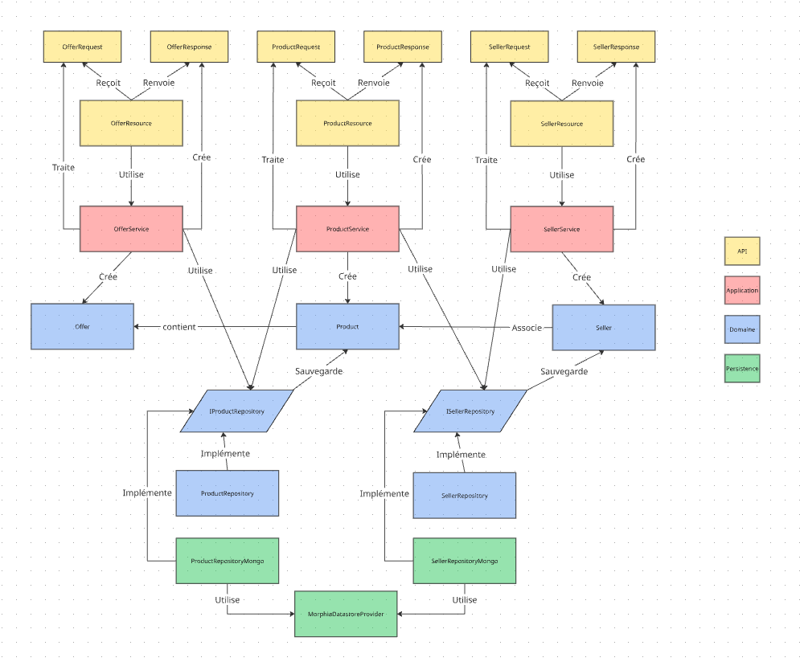

## ScreenShots

### GithubProject
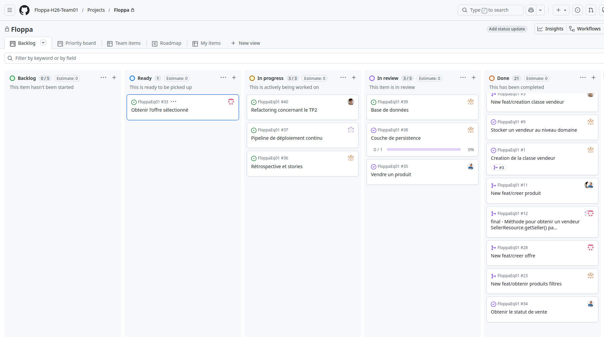

### Milestone

### Issue 1
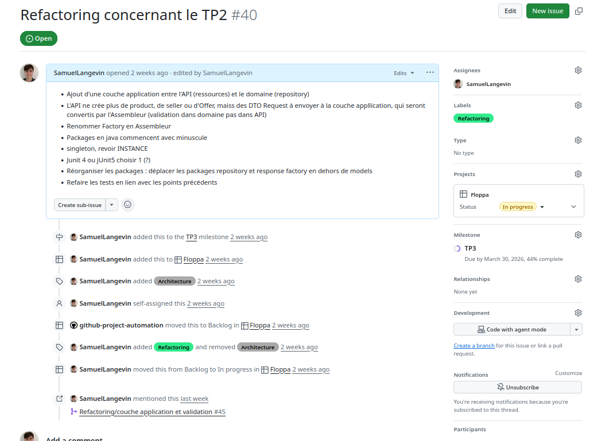

### Issue 2
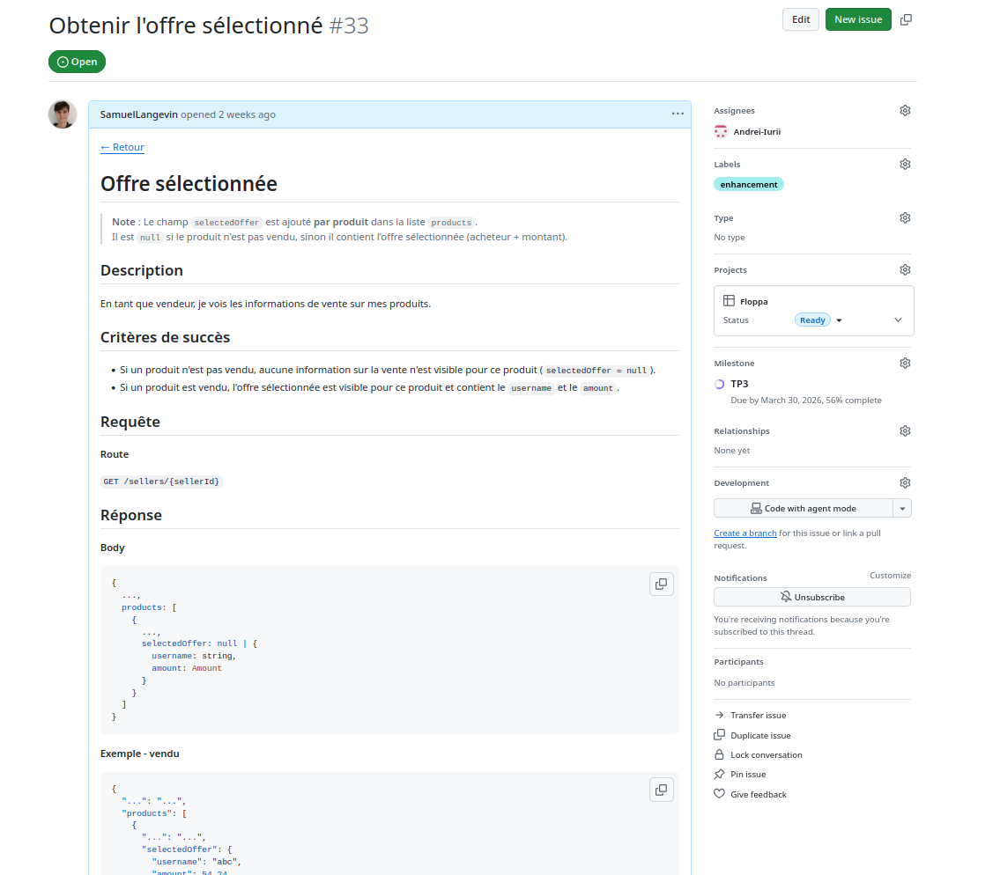

### Issue 3
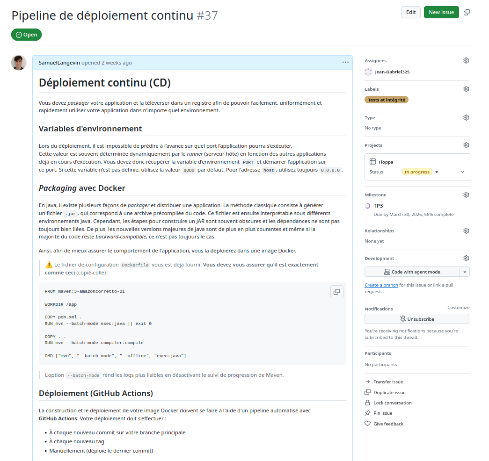
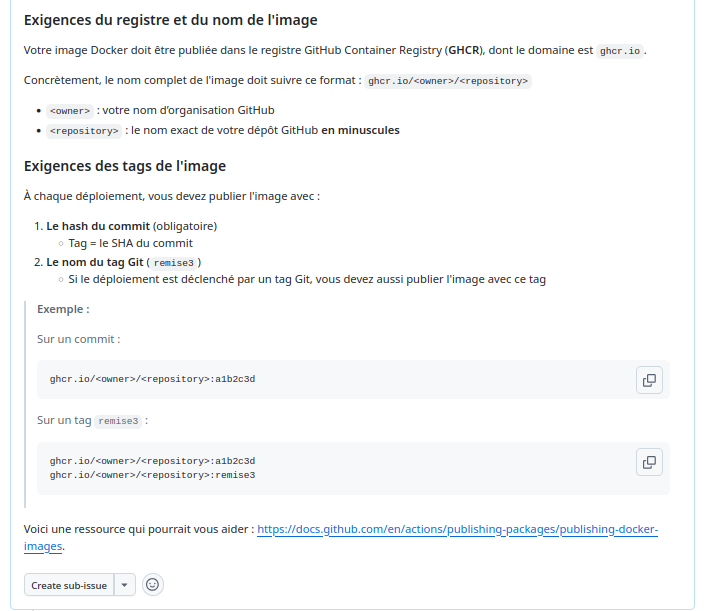

### Pull request 1

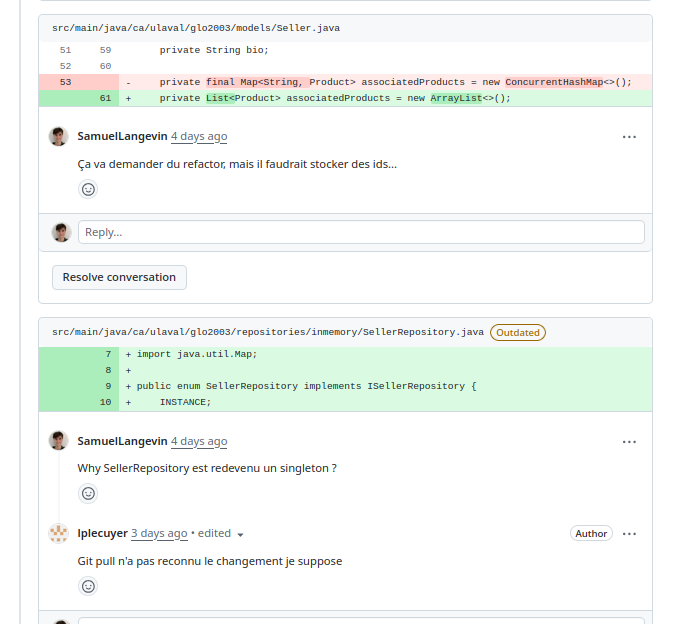

### Pull request 2 
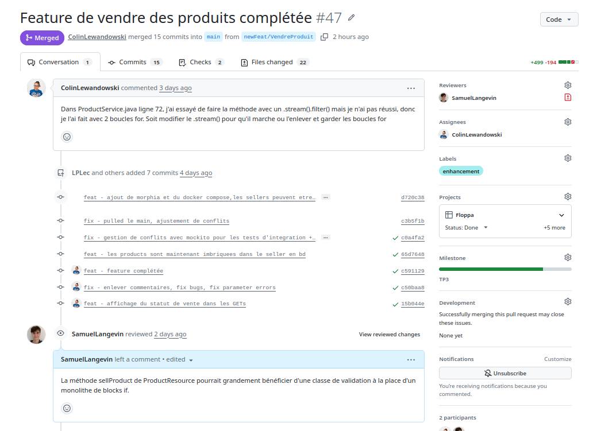

### Pull request 3
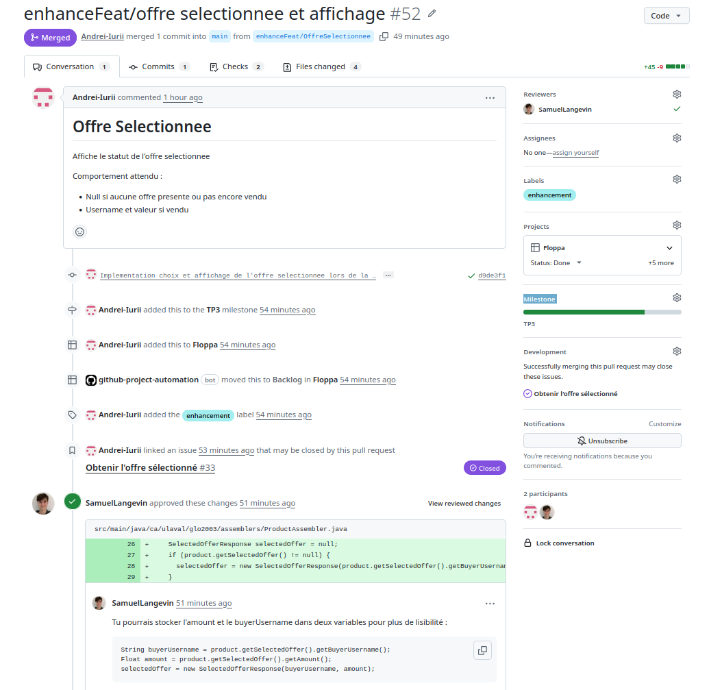

### Arbre de commits
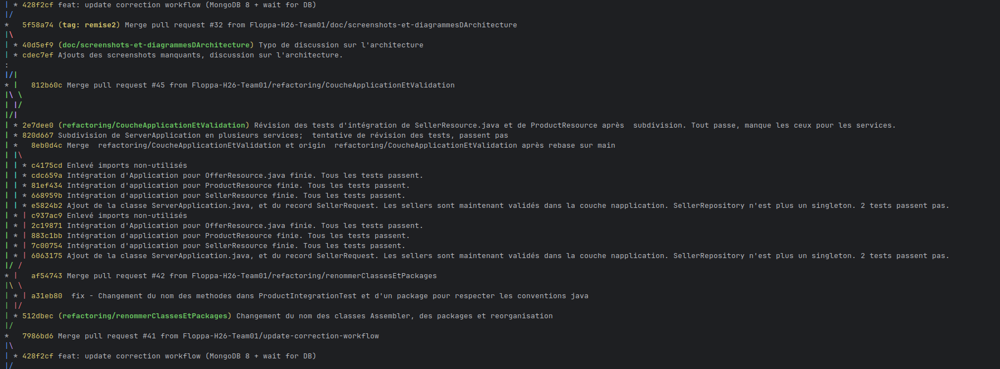
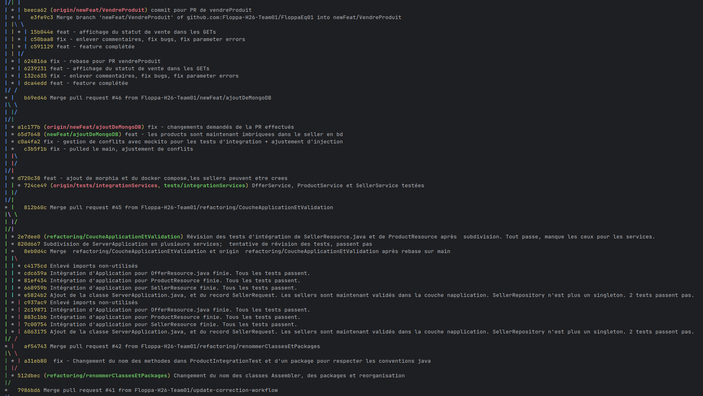
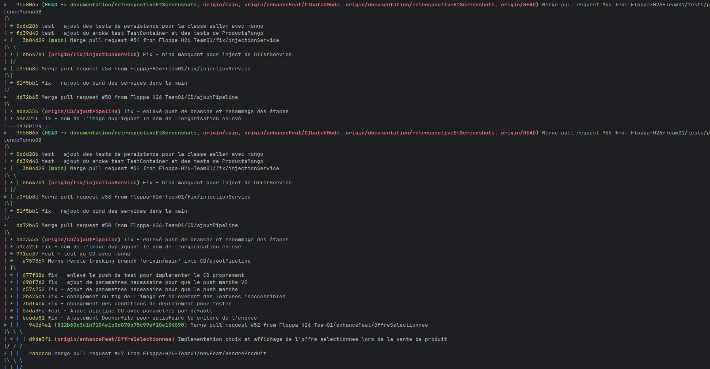

## Déclaration d'utilisation de l'IA
1. Commencer le travail sans utiliser d’IA.
2. Si le problème est en rapport avec le travail d’un coéquipier, lui demander de l’aide en premier.
3. Si un problème est rencontré, rechercher une solution sur google avec des sites fiables (StackOverflow, W3Schools, GeeksForGeeks) ou les notes de cours.
4. Si le problème persiste, demander de l’aide à un coéquipier.
5. Si rien n’est réglé, décrire le problème à ChatGPT textuellement et lui demander des pistes de la source de ce problème (sans scanner tout le code).
6. Si le problème est toujours là, utiliser ChatGPT pour le régler en formattant sa solution selon les conventions convenues et en s’assurant de bien comprendre sa réponse et qu’elle fonctionne bien.

## Formattage 
`mvn editorconfig:check`

